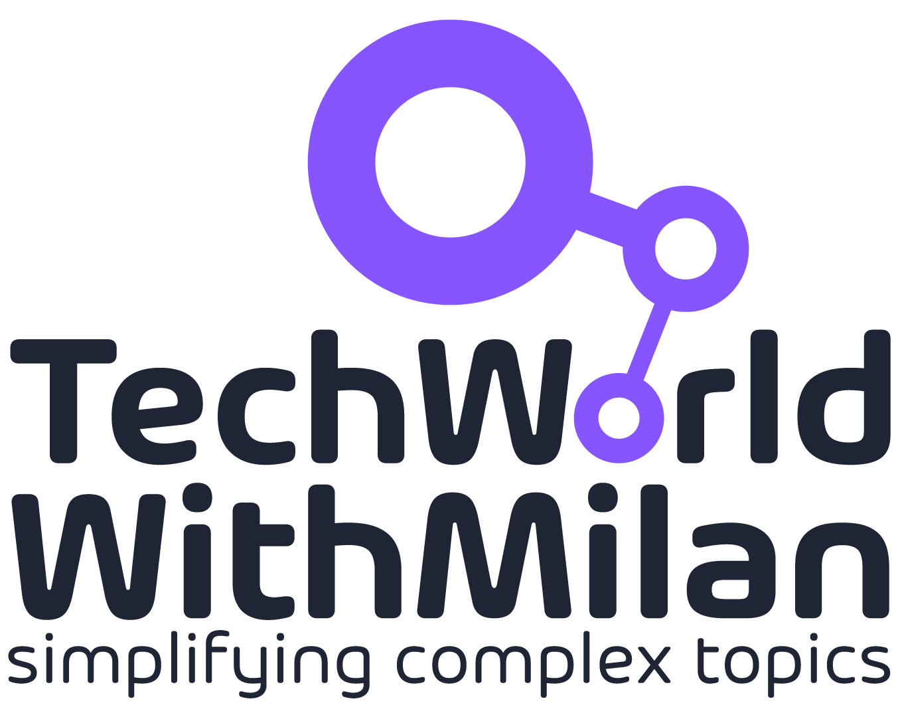

### Hi, I'm Milan 👋

I'm a CTO and the author of **[Laws of Software Engineering](https://lawsofsoftwareengineering.com)**. Over 20+ years, I've built software and engineering teams across finance, banking, energy, and more.

Today I help 400K+ engineers and leaders grow through better software, teams, and careers.

### 📖 My book: Laws of Software Engineering

A 300-page guide to 63+ laws and principles that shape software systems, teams, and decisions, from Conway's Law and Brooks's Law to CAP and Goodhart's Law. Forewords by Dr. Rebecca Parsons (CTO Emerita, Thoughtworks) and others.

**[Get the book »](https://lawsofsoftwareengineering.com)**

### ✉️ Newsletter

I write weekly on software engineering, architecture, and leadership. Join **50K+ engineers** reading every week.

**[Subscribe to Tech World With Milan »](https://newsletter.techworld-with-milan.com/)**

### 🚀 Popular projects

- [DevOps-Roadmap](https://github.com/milanm/DevOps-Roadmap) ⭐ – A step-by-step guide to becoming a DevOps engineer, with learning resources
- [azure-cheat-sheet](https://github.com/milanm/azure-cheat-sheet) ⭐ – A comprehensive Azure services cheat sheet

### 💬 Ask me about

Software architecture, Azure, C#/.NET, databases, DevOps, engineering management, coaching, and careers.

### 📫 Where to find me

- [LinkedIn](https://www.linkedin.com/in/milanmilanovic/)
- [X](https://twitter.com/milan_milanovic)
- [Substack](https://substack.com/@techworldwithmilan)
- [Bluesky](https://bsky.app/profile/milanmilanovic.bsky.social)
- [Website](https://milan.milanovic.org)
